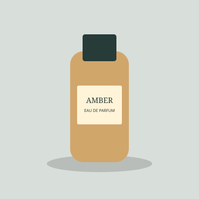
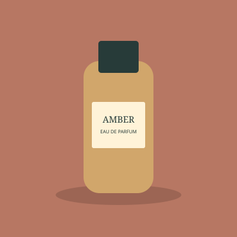
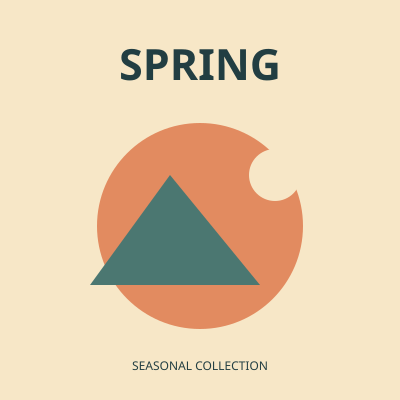
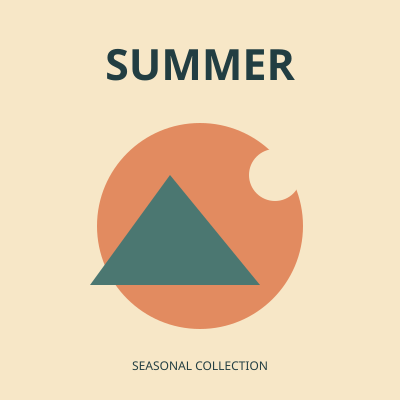

# Awesome AI Image Prompts

A source-aware collection of AI image generation and editing prompts. Browse visual examples and original creator links.

[中文](README.zh-CN.md) · [Sources](SOURCES.md) · [Contributing](CONTRIBUTING.md)

**4 original prompt examples · 811 indexed source cases**

Original examples below use hand-authored SVG illustrations, not model-generated results. Indexed third-party examples link to their creator/upstream gallery; their prompts and images are not mirrored until rights are cleared.

## Visual examples

### Image generation

**[Minimalist Cat Avatar](generation/avatars.md#original-minimalist-cat)**

 

**[Layered Sunset Landscape](generation/illustrations.md#original-sunset-landscape)**

 

### Image editing

**[Replace Product Background](editing/background-change.md#original-product-background)**

  

**[Replace Poster Headline](editing/text-editing.md#original-poster-text)**

  

## Browse by category

### generation

- [portraits](generation/portraits.md) (104)
- [avatars](generation/avatars.md) (4)
- [illustrations](generation/illustrations.md) (69)
- [products](generation/products.md) (33)
- [posters](generation/posters.md) (87)
- [characters](generation/characters.md) (80)
- [infographics](generation/infographics.md) (51)
- [travel](generation/travel.md) (40)

### editing

- [background change](editing/background-change.md) (1)
- [object removal](editing/object-removal.md) (1)
- [text editing](editing/text-editing.md) (2)
- [other](editing/other.md) (5)

### unclassified

- [other](unclassified/other.md) (338)

## Use online

You can try your own prompts in [AI Photo Editor](https://getaiphotoeditor.com/). This project is independently useful; the editor is maintained by the repository owner.

## Data and licensing

JSON is the source of truth. Run `npm run build` to regenerate Markdown. See [content policy](docs/content-policy.md) for rights and provenance.
