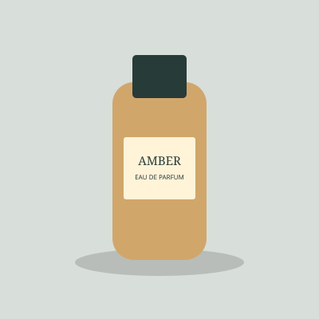
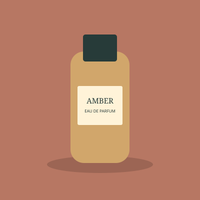

# background change

[← Home](../README.md)

<a id="original-product-background"></a>

## Replace Product Background

**input**



**output**



Illustrative fixture, not an AI model output. Prompt not yet tested.

```text
Replace only the background with a warm terracotta studio backdrop. Preserve the bottle, label, size, position, silhouette, and original framing. Keep the product recognizable and do not change the text.
```

Creator: Awesome AI Image Prompts contributors · License: CC0-1.0

