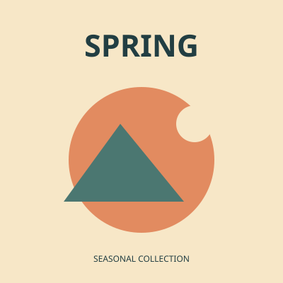

# text editing

[← Home](../README.md)

<a id="original-poster-text"></a>

## Replace Poster Headline

**input**



**output**


Illustrative fixture, not an AI model output. Prompt not yet tested.

```text
Replace only the headline 'SPRING' with 'SUMMER'. Match the original typeface, size, baseline, weight and alignment. Keep the shapes, background, color palette and all other elements unchanged.
```

Creator: Awesome AI Image Prompts contributors · License: CC0-1.0

## Source index

Open the collected case to view the source image and prompt. Classifications are provisional; original sources are reported by upstream and not independently checked.

| Case | Creator | Original post | Collected from |
|---|---|---|---|
| Snowy Evening Billboard Edit | @OpenAI | Not available | [evolink](https://github.com/Evolink-AI/awesome-gpt-image-2-6-prompts-and-api/blob/7fac7a7c73f3c9f681a1acbd8bf0af8b6b520b7b/cases/gpt-image-2-6.md#gpt-image-2-6-case-253) |
