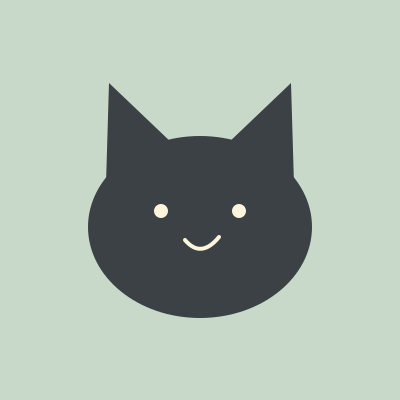

# avatars

[← Home](../README.md)

<a id="original-minimalist-cat"></a>

## Minimalist Cat Avatar

**output**



Illustrative fixture, not an AI model output. Prompt not yet tested.

```text
Create a playful minimalist vector avatar of a charcoal-gray cat with tiny round eyes, a crooked smile and a soft sage-green background. Use simple rounded shapes, generous negative space, no text, and a square composition.
```

Creator: Awesome AI Image Prompts contributors · License: CC0-1.0

## Source index

Open the collected case to view the source image and prompt. Classifications are provisional; original sources are reported by upstream and not independently checked.

| Case | Creator | Original post | Collected from |
|---|---|---|---|
| 暗黑极简头像网站视觉设计 | @xiaoxiaodong01 | [Original](https://x.com/xiaoxiaodong01/status/2046556758521573546) | [freestylefly](https://github.com/freestylefly/awesome-gpt-image-2/blob/0999cbfa1f860086db384602ee5ee5485671cb58/docs/gallery-part-2.md#case-188) |
| 高端 3D 收藏玩具头像 | @Genematicai | [Original](https://x.com/Genematicai/status/2050654848216109429) | [freestylefly](https://github.com/freestylefly/awesome-gpt-image-2/blob/0999cbfa1f860086db384602ee5ee5485671cb58/docs/gallery-part-2.md#case-378) |
| 儿童故事书手绘头像 | @Sairah_0 | [Original](https://x.com/Sairah_0/status/2090321208441262454) | [freestylefly](https://github.com/freestylefly/awesome-gpt-image-2/blob/0999cbfa1f860086db384602ee5ee5485671cb58/docs/gallery-part-2.md#case-522) |
