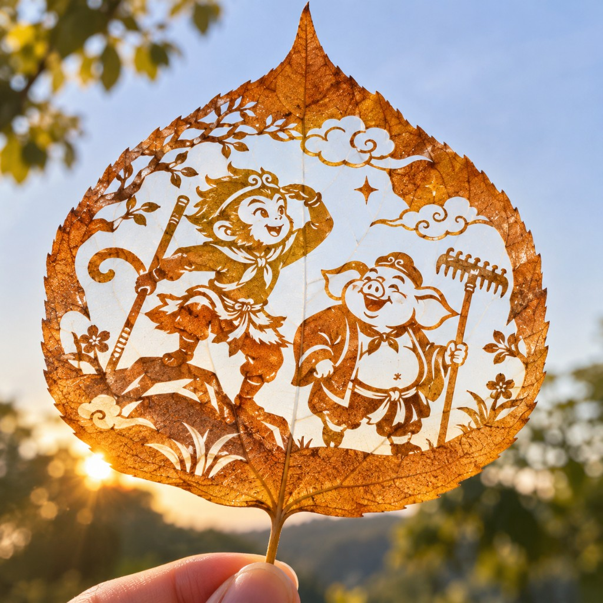

# creative art

[← Home](../README.md) · Page 2 / 12

[1](creative-art.md) · **2** · [3](creative-art-3.md) · [4](creative-art-4.md) · [5](creative-art-5.md) · [6](creative-art-6.md) · [7](creative-art-7.md) · [8](creative-art-8.md) · [9](creative-art-9.md) · [10](creative-art-10.md) · [11](creative-art-11.md) · [12](creative-art-12.md)

Source examples are not independently reproduced. Copy a prompt from its code block; original formatting is preserved in JSON.

<a id="freestylefly-case-329"></a>

## 烬甲猎鹰者与燃翼神禽

<a href="https://raw.githubusercontent.com/freestylefly/awesome-gpt-image-2/0999cbfa1f860086db384602ee5ee5485671cb58/data/images/case329.jpg"></a>

**Prompt**

```text
[中文] 一幅充满奇幻色彩的电影场景：一位英姿飒爽的女战士兼猎鹰师，身着饱经战火洗礼、饰以闪耀余烬纹理的皮甲，漫步于幽暗迷雾笼罩的森林之中。她高举手臂，指挥着一头巨大的凤凰与雄鹰的混合体，这头猛禽双翼燃烧，羽毛燃焰，尖端喷吐着火焰。它周身散发着橙红色的熔岩光芒，火星和余烬飞溅。女战士梳着辫子，皮肤上沾满了灰烬，神情坚定，手中拿着绳索和工具袋。画面细节丰富，羽毛纹理逼真，火焰物理效果自然，光照效果极具戏剧性，运用了体积雾、浅景深等技术，营造出史诗般的奇幻氛围，色彩调校极具电影质感，背景阴郁深沉，分辨率高达8K，呈现出概念艺术的精髓，并采用了虚幻引擎的渲染效果。 [English] A cinematic fantasy scene of a fierce female use image for face reference warrior falconer walking through a dark misty forest, wearing battle-worn leather armor infused with glowing ember textures. Her arm is raised, commanding a massive phoenix-eagle hybrid with blazing wings and flaming feathers, fire trailing from its tips. The bird radiates molten orange and red light, casting sparks and embers into the air.The warrior has braided hair, ash-streaked skin, and a determined expression, carrying a rope and utility pouch. Ultra-detailed feathers, realistic fire physics, dramatic lighting, volumetric fog, shallow depth of field, epic fantasy atmosphere, hyper-realistic, cinematic color grading, dark moody background, 8k, concept art, unreal engine quality.
```

By [@iamsofiaijaz](https://x.com/iamsofiaijaz/status/2008896649901535342)

---

<a id="freestylefly-case-370"></a>

## Crumple Chair 概念沙发研发板

<a href="https://raw.githubusercontent.com/freestylefly/awesome-gpt-image-2/0999cbfa1f860086db384602ee5ee5485671cb58/data/images/case370.jpg"></a>

**Prompt**

```text
Design Concept: The Crumple Chair Core Philosophy: Translating the "controlled chaos" of a tossed paper ball into a sculptural, high-comfort seating experience. Stage 1: Observation & Morphological Analysis The goal is to deconstruct the image of the crumpled paper into usable geometric data. Crease Mapping: Identify the primary "valley" and "ridge" lines. These represent potential structural ribs or seams in the chair. Faceted Planes: Break down the sphere into a series of non-uniform polygons. Each flat surface of the paper becomes a potential panel for the chair’s upholstery or shell. Shadow Study: Analyze how the "tossed" form creates deep recesses. These natural pockets guide where the user’s weight will be cradled. Stage 2: Iterative Form Exploration Moving from a sphere to a seat through "Digital Crumpling." Subtractive Sculpting: Imagine the paper ball as a solid mass. Use Boolean operations to "carve out" a seating cavity that fits the human form while maintaining the external jagged texture. Tension Simulation: Use 3D software (like Rhino or Blender) to simulate a flat sheet of material being compressed. This ensures the folds look authentic and not "modeled." The "Toss" Logic: Experiment with gravity-based simulation dropping a digital mesh to see how it settles naturally, mimicking the "tossed" origin. Stage 3: Ergonomic Translation & Blueprinting Refining the raw aesthetic into a functional object. The Comfort Core: Overlay a standard ergonomic template (Seating Angle: 105°–110°) over the crumpled form. Adjust the internal "folds" to provide lumbar support and pressure relief. Blueprint Generation: Create technical orthographic views (Front, Side, Top). Map out the dimensions: Seat Height: 450mm Total Width: 850mm Surface Smoothing: Maintain the sharp "paper edges" on the exterior shell while softening the interior contact points for skin comfort. Stage 4: Structural Integration & Scaling Making the concept physically viable. The Skeleton: Design a hidden internal frame (likely CNC-bent steel rods or a 3D-printed lattice) that follows the most prominent ridges of the paper folds to provide rigidity. Material Selection: * Option A (High-End): Faceted, cast aluminum with a white powder coat. Option B (Soft): Vacuum-formed recycled plastic shell covered in "memory-fold" technical fabric that retains a wrinkled appearance. Stage 5: Final Prototyping & Material Finish Textural Replication: Apply a matte, slightly porous finish to the material to mimic the tactile feel of heavy-bond paper. Lighting Contrast: Use directional studio lighting in the final renders to emphasize the "tossed" shadows, making the chair look like a giant piece of discarded inspiration. Design Tip: To keep the "tossed" look authentic, avoid symmetry. The most compelling aspect of a crumpled paper ball is its unique irregularity—ensure the left and right sides of the chair are balance-equivalent but not identical
```

By [@ShamsAmin56](https://x.com/ShamsAmin56/status/2050281206139461780)

---

<a id="freestylefly-case-382"></a>

## 春日花田三联竖版写真拼贴

<a href="https://raw.githubusercontent.com/freestylefly/awesome-gpt-image-2/0999cbfa1f860086db384602ee5ee5485671cb58/data/images/case382.jpg"></a>

**Prompt**

```text
A high-quality 3-panel vertical photo collage of a stunning uploaded woman with soft, voluminous wavy hair glowing in golden sunlight. She is styled in a cream-colored lace-up vintage blouse with delicate textures, olive green high-waisted flowy trousers, and a wide-brimmed straw hat slightly tilted for a fashionable editorial look. Light golden jewelry (thin chains, rings) adds a subtle luxury touch. The setting is a dreamy, vibrant yellow mustard flower field under a bright blue sky with soft clouds, enhanced by golden hour lighting for a magical glow. Top panel: Back view of the woman standing in the field with arms wide open, sunlight creating a glowing halo around her hair, slight motion blur in flowers for a cinematic feel. Middle panel: Close-up portrait, she smiles naturally at the camera, wind softly moving her hair, her hand reaching toward the lens creating depth and a slightly blurred foreground for a DSLR effect. Bottom panel: Playful pose, she leans sideways in the flowers, making a double peace sign, laughing candidly, capturing an authentic joyful moment. Add cute, trendy white doodle overlays (smiley faces, sparkles, stars, tiny hearts) with a subtle animated/sketchy feel. Include light leaks, sun flares, and soft film grain for a premium Instagram aesthetic. Ultra-realistic, 4K, cinematic lighting, shallow depth of field, high dynamic range, natural skin tones, editorial fashion photography, soft pastel color grading. Aspect ratio: 4:5 Style tags: viral Instagram aesthetic, Pinterest style, dreamy spring vibe, candid luxury
```

By [@frametheory058](https://x.com/frametheory058/status/2051294907214844249)

---

<a id="freestylefly-case-390"></a>

## 羊毛毡国家微缩世界

<a href="https://raw.githubusercontent.com/freestylefly/awesome-gpt-image-2/0999cbfa1f860086db384602ee5ee5485671cb58/data/images/case390.jpg"></a>

**Prompt**

```text
Country: [INSERT COUNTRY NAME] A miniature felt diorama made of fluffy yarn, wool, and needlework, designed as a single cohesive small world (not a collage), reflecting the real landscape, culture, and daily life of the country. Structure: - Select 4–7 naturally integrated elements (landscape, architecture, transport, street life, culture) - Everything must flow together as one environment Foreground: Everyday life — small shops, cafes, markets, people interacting, local clothing, street details, subtle movement, warm human presence Midground: Connecting flow — streets, bridges, rivers, paths, transport, cultural spaces that guide the eye naturally from front to back Background: One strong identity anchor — landmark, skyline, mountain, or symbolic landscape clearly representing the country (keep it clean, not overcrowded) Style: Handmade wool felt, yarn, needle-felt textures, visible fibers, soft edges, miniature craftsmanship, premium diorama realism Lighting: Warm golden hour or bright noon, soft shadows, clear visibility, gentle glow enhancing depth Color: Soft but saturated palette reflecting the country’s natural tones (greens, sky blues, architectural hues, cultural accents), warm and balanced Composition: Vertical frame, balanced or centered perspective, slight top-down or immersive angle, clear foreground–midground–background depth Mood: Warm, emotional, calm, refined — like a handcrafted fairy-tale version of real life (not childish) Rules: - No logos or text overlays - No collage-style composition - No random symbolic clutter - Keep it realistic but stylized as a handmade miniature world Quality: 16K, ultra-detailed, hyper-realistic miniature textures, cinematic depth, sharp focus output_goal: A single, cohesive felt diorama world that instantly conveys the identity and atmosphere of the chosen country through integrated landscape, culture, and daily life
```

By [@volkan\_iras](https://x.com/volkan_iras/status/2051403524966141980)

---

<a id="freestylefly-case-394"></a>

## 中世纪村庄双精灵冒险者

<a href="https://raw.githubusercontent.com/freestylefly/awesome-gpt-image-2/0999cbfa1f860086db384602ee5ee5485671cb58/data/images/case394.jpg"></a>

**Prompt**

```text
Create a cinematic dark-fantasy medieval street scene in ultra-realistic 3D game concept art style, widescreen 16:9. In the foreground, show two adult elven adventurers walking side by side toward the viewer through a muddy cobblestone village road. The left character is a pale-skinned elf woman with long messy {argument name="left character hair color" default="ash blonde"} braided hair, pointed ears, layered olive-green druid robes, leather belts, pouches, dangling metal charms, necklaces, torn fabric strips, leaf-and-feather details, and glowing white vine-like magical tattoos spiraling down both forearms. The right character is a darker-skinned elf woman with long thick {argument name="right character hair color" default="dark brown"} dreadlocked hair, pointed ears, a green-and-brown leather ranger outfit, fur shoulder mantle, feather ornaments, arm wraps, belts, chains, talismans, and a confident warrior posture. Both faces are intentionally hidden by plain opaque {argument name="face covering color" default="dark brown"} square censor blocks, centered over their faces. Set the background in a richly detailed medieval market village with timber-and-thatch houses, hanging bundles of dried herbs on the right-side shopfront, barrels, baskets, wooden stalls, distant townspeople, and a large stone castle with towers and battlements rising in the background. Use {argument name="lighting mood" default="warm late-afternoon golden sunlight"}, dramatic shadows, volumetric haze, shallow depth of field, realistic fabric and leather textures, high detail, moody fantasy atmosphere, cinematic composition, Unreal Engine quality, no text, no logos.
```

By [@RamonVi25791296](https://x.com/RamonVi25791296/status/2051568239142973832)

---

<a id="freestylefly-case-398"></a>

## 8 套日常穿搭编辑拼贴

<a href="https://raw.githubusercontent.com/freestylefly/awesome-gpt-image-2/0999cbfa1f860086db384602ee5ee5485671cb58/data/images/case398.jpg"></a>

**Prompt**

```text
Create a freeform fashion-editorial collage of me in 8 distinct full-body casual wear, arranged organically on a clean cream studio backdrop. Keep my face identical across all looks, w/ consistent proportions that visually read as around (height) w/o stating height. Include subtle handwritten-style arrows & labels highlighting key pieces. Avoid any grids, borders, or boxed layouts.
```

By [@aiwithaly](https://x.com/aiwithaly/status/2052218645951205463)

---

<a id="freestylefly-case-461"></a>

## 家庭旅行纸雕拼贴

<a href="https://raw.githubusercontent.com/freestylefly/awesome-gpt-image-2/0999cbfa1f860086db384602ee5ee5485671cb58/data/images/case461.jpg"></a>

**Prompt**

```text
Adorable kawaii family travel collage, combining four different scenes in one composition, cute anime-inspired parents, friends and children taking selfies and exploring together, handcrafted paper-cut diorama style, layered cardboard and felt textures, miniature world aesthetic, cozy pastel color palette, soft cinematic lighting, playful vacation atmosphere, urban city station scene, shopping mall selfie corner, outdoor nature park, and crowded playground blended into one seamless scrapbook-style artwork, charming sticker-like white outlines around characters, tiny tourists and pedestrians in background, whimsical handcrafted textures, soft depth of field, highly detailed paper craft illustration, warm nostalgic mood, cute casual outfits with glasses, caps, bags and sandals, dreamy Instagram kawaii aesthetic, storybook composition, ultra detailed miniature environment, 3D layered paper art, tilt-shift effect, cozy wholesome family travel vibes, premium handcrafted look, high detail, 8k, vertical composition
```

By [@Taaruk\_](https://x.com/Taaruk_/status/2058400056722731079)

---

<a id="freestylefly-case-473"></a>

## ROGUE VIPER 游戏概念设定板

<a href="https://raw.githubusercontent.com/freestylefly/awesome-gpt-image-2/0999cbfa1f860086db384602ee5ee5485671cb58/data/images/case473.jpg"></a>

**Prompt**

```text
**ROGUE VIPER — VIDEO GAME CONCEPT ART SHEET PROMPT** --- Official AAA video game concept art sheet titled **'ROGUE VIPER'** for an Unreal Engine 5 third-person action-stealth game. Professional game development documentation layout on a dark charcoal #1A1A1A background with gold stencil label typography throughout. Four clearly labeled panels arranged in a 2×2 grid with a header and footer. --- **SHEET HEADER** — Bold gold stencil font title text: **ROGUE VIPER** centered at top. Subtitle beneath in smaller tracking-heavy label font: **CHARACTER & ENVIRONMENT CONCEPT SHEET | UNREAL ENGINE 5 | ACTION / STEALTH — THIRD PERSON** --- **PANEL 1 — TOP LEFT — Label: "PROTAGONIST: MEI LIU / ROGUE VIPER"** Full-body character turntable reference of a 30-year-old East Asian Chinese-American female operative. Athletic and toned, 5'8", long straight black hair worn loose, calm neutral expression with sharp eyes. Wearing a form-fitting matte black tactical bodysuit with gold accent seams running along the shoulders, forearms, and thighs, gold cobra snake belt buckle at the waist, calf-high black tactical boots with subtle gold trim. Armed with twin suppressed 9mm pistols holstered on each hip with custom viper-scale grip texture, a serrated combat knife sheathed vertically on the right thigh, and a compact pneumatic grappling hook launcher mounted on the left forearm. Three views arranged side-by-side: front, 3/4, and back. Unreal Engine 5 physically-based rendering, photorealistic skin and fabric materials, neutral 3-point studio lighting for maximum clarity, gold and matte black color scheme throughout. --- **PANEL 2 — TOP RIGHT — Label: "ENEMY TYPE 01: OBSIDIAN PROTOCOL ENFORCER"** Three enemy soldiers shown as character references against a dark background. These are elite private military contractors working for a shadow arms cartel called Obsidian Protocol. Their uniform: slate-gray and black modular plate carriers with deep crimson geometric hex-patch insignia on the shoulder, full-face ballistic visors with a dark red tinted lens, black tactical gloves, reinforced combat boots. Armed with compact bullpup assault rifles with red laser sights. One figure standing in neutral patrol stance, one crouched in a ready alert position, one depicted mid-aim with rifle raised. All three shown at the same scale for comparison. Same UE5 photorealistic PBR render style. Crimson and slate-gray color language to contrast Viper's gold and black. --- **PANEL 3 — BOTTOM LEFT — Label: "STEALTH ENVIRONMENT: OBSIDIAN PROTOCOL BLACK SITE — ALPINE RESEARCH FACILITY"** Wide cinematic establishing shot of a stealth mission environment. A hidden high-altitude research facility buried inside a snow-covered mountain, accessible only via an underground tram. Interior architecture is brutalist concrete and frosted glass, dimly lit with cold white fluorescent overhead strips and amber emergency lighting casting long dramatic shadows across polished concrete floors. Rows of classified server terminals and cryogenic storage units line the walls. Ventilation shafts visible in the ceiling above catwalks. A security camera sweeps a slow arc over a central corridor below. In the foreground, Rogue Viper is pressed flat against a concrete pillar in deep shadow, body low, watching two Obsidian Protocol enforcers on patrol below, one holding a flashlight. The scene communicates tension, patience, and tactical opportunity. Unreal Engine 5 Lumen global illumination, volumetric cold air haze, photorealistic ice and concrete materials, deep crushed blacks with cold white and amber lighting contrast. Cinematic wide 2.39:1 style composition within the panel. --- **PANEL 4 — BOTTOM RIGHT — Label: "ACTION SET PIECE: OBSIDIAN PROTOCOL FREIGHT DEPOT — COLLAPSED BRIDGE CANYON"** Wide cinematic action shot of a high-octane firefight environment. A sprawling open-air industrial freight depot at the edge of a sheer cliff canyon at dusk, with a collapsed suspension bridge dangling over the chasm below. Shipping containers and heavy crane equipment provide cover geometry. Rogue Viper is captured mid-movement in a dynamic gunfight pose — body low, both suppressed pistols raised and firing, muzzle flashes illuminating her face with sharp white light. Three Obsidian Protocol enforcers are positioned around her — one diving behind a container, one firing from atop a crane platform, one falling backward off the edge of the depot platform. Background: deep canyon with a river of orange reflected sunset light far below, dust and smoke rising from the firefight, a military helicopter approaching in the far distance. Warm dusk amber and cool canyon shadow blue provide dramatic color contrast. UE5 ray-traced reflections on metal container surfaces, particle systems for dust and muzzle smoke, cinematic depth of field on background elements. --- **SHEET FOOTER** — Color palette chip row along the bottom of the sheet: matte black #1A1A1A, dark charcoal #2B2B2B, viper gold #D4AF37, gunmetal #3E3E3E, obsidian crimson #8B1A1A, slate gray #6B7280, cold white #E8EEF4. Label above chips: **COLOR PALETTE**. Footer text beneath: **ACTION / STEALTH — THIRD PERSON — UNREAL ENGINE 5 — © ROGUE VIPER GAME STUDIOS** --- **UNIVERSAL STYLE CONSTRAINTS — APPLY TO ALL PANELS:** Photorealistic only throughout the entire sheet. No anime, no cartoon, no stylized illustration, no cel shading, no comic book rendering. Unreal Engine 5 cinematic render quality with physically-based materials. Anamorphic lens character on all environment shots. Crushed blacks and desaturated mid-tones across all panels. Professional AAA game studio concept documentation format comparable to Naughty Dog, Ubisoft, or Guerrilla Games internal production art.
```

By [@KimAkiyama81](https://x.com/KimAkiyama81/status/2059394334378566063)

---

<a id="freestylefly-case-476"></a>

## 早安拿铁微缩女孩

<a href="https://raw.githubusercontent.com/freestylefly/awesome-gpt-image-2/0999cbfa1f860086db384602ee5ee5485671cb58/data/images/case476.jpg"></a>

**Prompt**

```text
Create ultra-fine highly detailed 3D realistic miniature chibi-like cute girl, wearing cream colour top and jeans, resting and floating on creamy latte cup, stylized textured ceramic cup, sleeping expression, satin soft pillow tucked behind her head. The latte cream forms a text "Good Morning" in a cute handwriting. Soft-focus minimalist background, bright natural light, 8K UHD.
```

By [@Zyrellix](https://x.com/Zyrellix/status/2059443447602561444)

---

<a id="freestylefly-case-485"></a>

## 时尚目录电商拼贴

<a href="https://raw.githubusercontent.com/freestylefly/awesome-gpt-image-2/0999cbfa1f860086db384602ee5ee5485671cb58/data/images/case485.jpg"></a>

**Prompt**

```text
Stylish fashion catalog shoot blending streetwear and luxury branding. Female model wearing burgundy slim-fit top and ivory tailored pants, posed in confident relaxed positions across multiple duplicated frames. Slight perspective tilt, dynamic layout collage, soft daylight studio lighting with warm tone grading. Modern shopping website aesthetic, minimal UI-inspired composition, high resolution fashion photography.
```

By [@Mind\_Boticni](https://x.com/Mind_Boticni/status/2061310969192870028)

---

<a id="freestylefly-case-537"></a>

## 地下档案馆暗黑概念海报

<a href="https://raw.githubusercontent.com/freestylefly/awesome-gpt-image-2/0999cbfa1f860086db384602ee5ee5485671cb58/data/images/case537.jpg"></a>

**Prompt**

```text
Use case: stylized-concept Asset type: vertical social-media artwork for the “Your Dark Side” theme Create an original psychological dark-surrealist scene in a colossal underground archive. Endless shelves of sealed black books rise like skyscrapers and vanish into fog. In the central aisle, a solitary human figure in bone-white clothing kneels before one open book on the floor. No words are visible. From the blank pages rises a delicate life-size figure made entirely of dense black smoke, standing face-to-face with the kneeling person. The smoke figure has no eyes or mouth; instead, its chest contains a small locked crimson door. Thin threads connect that door to the kneeling person’s hands, suggesting a secret self finally acknowledged. Vertical 9:16 framing, towering shelves create a narrow symmetrical canyon, high-angle shaft of cold silver light, the two figures positioned small in the lower center, immense oppressive scale above them. Black paper, aged stone, floating ash, volumetric fog, subtle polished-floor reflections, premium photorealistic dark concept art, refined editorial composition, quiet dread and introspection rather than horror spectacle. Color palette: obsidian black, graphite, bone white, cold silver, a single muted crimson accent at the tiny door. Constraints: entirely original metaphor; blank book pages with absolutely no writing; no recognizable person; no text, symbols, logos, signatures, borders, or watermark. Avoid: visible letters or runes, portrait close-up, split face, black substance on skin, glowing eyes, gore, skulls, conventional ghosts, fantasy wizard styling, imitation of any named artist.
```

By [@PromptSin](https://x.com/PromptSin/status/2092390329890849163)

---

<a id="manual-leaf-carving-storytelling"></a>

## Charming Leaf Carving Storytelling Artwork

<a href="https://raw.githubusercontent.com/CoderLim/awesome-ai-image-prompts/main/data/media/manual/leaf-carving-storytelling.jpg"></a>

**Prompt**

```text
Create an exceptionally charming and imaginative leaf carving artwork based on the following scene: **SCENE: {{scene}}** ### 1. ARTISTIC CONCEPT Transform a single real natural leaf into an exquisite miniature storytelling world through delicate hand-cut leaf carving and intricate negative-space art. The scene must be physically carved into the leaf itself, rather than painted, printed, or digitally superimposed onto its surface. Use the remaining leaf material to form characters, objects, architecture, plants, and decorative elements, while carefully carved openings reveal the real background through the leaf. ### 2. NATURAL LEAF MATERIAL Select the most suitable natural leaf shape, size, orientation, and color according to the scene. Preserve authentic organic characteristics: - Clearly visible natural leaf veins. - Realistic botanical surface texture. - Subtle natural imperfections and color variations. - Thin, delicate leaf edges. - An intact, naturally attached leaf stem. The leaf may be fresh green, olive green, golden brown, or autumn reddish-brown, depending on the emotional atmosphere. ### 3. CREATIVE COMPOSITION Intelligently interpret the scene and translate it into a beautiful miniature silhouette composition. Choose the most suitable carving structure: - A partially preserved leaf with an open storytelling window. - A half-leaf composition with the central vein forming a structural boundary. - A horizontal miniature landscape supported by the lower half of the leaf. - An organically shaped silhouette that follows the natural outline of the leaf. Do not restrict every composition to the same leaf shape or layout. Use the natural veins, edges, and remaining leaf material as integral parts of the storytelling design. Keep the composition visually balanced, charming, recognizable, and emotionally expressive. ### 4. CHARACTER AND SCENE DESIGN Render characters and objects as delightful, simplified, hand-crafted silhouettes with playful proportions, expressive gestures, and delicate details. Create facial expressions, eyes, clothing details, and decorative patterns using carefully carved negative spaces. Where appropriate, incorporate small botanical or atmospheric details such as flowers, grass, mushrooms, butterflies, stars, hearts, raindrops, or tiny branches. Every decorative element must complement the scene rather than overcrowd it. All carved elements must remain physically connected to the original leaf through natural veins, ground silhouettes, branches, or subtle structural connections. No disconnected or floating leaf fragments. ### 5. CARVING TECHNIQUE Combine solid silhouettes, fine contour carving, intricate hollow-out details, and large open negative spaces. The carved openings must be genuinely transparent, allowing the real sky, sunlight, and background scenery to remain visible through them. Maintain a believable balance between delicate craftsmanship and physical structural integrity. The result should resemble an extraordinary handmade botanical artwork created by a skilled leaf-carving artist. ### 6. PHOTOGRAPHY AND ENVIRONMENT Present the finished artwork as a highly realistic outdoor close-up photograph. The leaf is gently held by its stem between human fingertips or naturally positioned upright on a wooden surface. Use an atmospheric natural background selected to complement the scene: - Clear blue sky. - Soft pastel sunset. - Golden-hour sunlight. - Dreamy pink evening sky. - Gentle cloudy daylight. - Softly blurred green foliage. Use natural backlighting, shallow depth of field, beautiful organic bokeh, and realistic light transmission through the carved openings. Keep the leaf artwork in sharp focus while the background remains softly blurred. ### 7. EMOTIONAL ATMOSPHERE Whimsical, heartwarming, peaceful, poetic, playful, nostalgic, and full of childlike wonder. The artwork should feel like a tiny fairy-tale world hidden within an ordinary leaf, transforming simple everyday moments into something magical. ### 8. FINAL IMAGE REQUIREMENTS Photorealistic handmade leaf carving, authentic botanical texture, exquisite craftsmanship, clean silhouettes, intricate negative-space design, natural outdoor photography, soft cinematic lighting, exceptionally detailed macro photography, artistic composition, high resolution. Square 1:1 composition, with the entire carved leaf clearly visible and sufficient breathing space around it. No digital illustration, no painted leaf surface, no printed graphics, no artificial paper texture, no plastic materials, no floating fragments, no excessive decorations, no watermark, no logo, and no unrelated text. Generate the final image directly.
```

By [CoderLim](https://github.com/CoderLim/awesome-ai-image-prompts/blob/main/data/media/manual/leaf-carving-storytelling.jpg)

---

<a id="prompthero-0b1e8c269a2"></a>

## \{ &quot;scene&quot;: \{ &quot;setting&quot;: &quot;inside a swirling t\.\.\.

<a href="https://cdn.prompthero.com/v1_a99224c8869cbccfd372051d1a-hero-10-scene-setting-inside-a-swirling-tornado-mood-dramatic-and-surreal-style-hyper-realistic-fashion-editorial-lighting-high-contrast-with-stormy.jpeg"></a>

**Prompt**

```text
{ "scene": { "setting": "inside a swirling tornado", "mood": "dramatic and surreal", "style": "hyper-realistic, fashion editorial", "lighting": "high contrast with stormy overcast sky", "atmosphere": "intense, with debris flying and motion blur around edges" }, "subject": { "type": "girl", "age": "20", "expression": "focused, intense", "pose": "falling or flying upwards with foot toward camera", "outfit": { "top": "blue gingham dress", "shoes": "bold red Crocs" }, "hair": "braided, swept upward by wind", "accessories": { "animal": "small fluffy dog held under her arm" } }, "camera": { "angle": "extreme wide-angle, low perspective from foot upward", "lens": "ultra wide-angle", "motion": "dynamic motion blur on foot and background debris", "focus": "sharp on girl’s face and dress, blurred background" }, "effects": { "wind": "clothes and hair dramatically lifted", "debris": "leaves and dirt spiraling around", "sky": "dark and stormy with funnel clouds" }, "composition": { "foreground": "large red Croc in extreme perspective", "background": "tornado spiral and flying particles" } }
```

By [@albertoantoniot](https://prompthero.com/prompt/0b1e8c269a2-hero-10-scene-setting-inside-a-swirling-tornado-mood-dramatic-and-surreal-style-hyper-realistic-fashion-editorial-lighting-high-contrast-with-stormy)

---

<a id="prompthero-0b6df7f515f"></a>

## dachshund dog, red, one eye blue, the other brown,\.\.\.

<a href="https://cdn.prompthero.com/uf699nqf9m19j8d0q3ne14denx30-midjourney-niji-v6-dachshund-dog-red-one-eye-blue-the-other-brown-wearing-large-marshall-headphones-a-red-down-jacket-standing-on-the.png"></a>

**Prompt**

```text
dachshund dog, red, one eye blue, the other brown, wearing large Marshall headphones, a red down jacket, standing on the road against the backdrop of a rainy city, futuristic style --stylize 700
```

[Source](https://prompthero.com/prompt/0b6df7f515f-midjourney-niji-v6-dachshund-dog-red-one-eye-blue-the-other-brown-wearing-large-marshall-headphones-a-red-down-jacket-standing-on-the)

---

<a id="prompthero-0c97785b276"></a>

## Transform to extreme vivid fantasy realism style a\.\.\.

<a href="https://cdn.prompthero.com/tji7lpvibmvsu5nykoibu5h8yb4r-flux-flux-11-pro-transform-to-extreme-vivid-fantasy-realism-style-art-ultra-detailed-masterpiece-depiction-of-medusa-from-marvel-inc-in-hyper-realistic.jpg"></a>

**Prompt**

```text
Transform to extreme vivid fantasy realism style art, ultra-detailed masterpiece, depiction of Medusa from Marvel Inc., in hyper-realistic fantasy digital photography, meticulously captured with precision and care, centered, perfect composition, overexposed photography creating a striking and ethereal atmosphere, sharp focus ensuring exquisite details, clear and bright elements highlighting her iconic red hair, expressive eyes filled with regal command and inner turmoil, the intricate details showcasing her flowing hair and stoic pose, seamlessly merging realism with fantasy, celebrating the essence of power and her inner conflicts in a visually stunning and imaginative setting.
```

[Source](https://prompthero.com/prompt/0c97785b276-flux-flux-11-pro-transform-to-extreme-vivid-fantasy-realism-style-art-ultra-detailed-masterpiece-depiction-of-medusa-from-marvel-inc-in-hyper-realistic)

---

<a id="prompthero-0d3dd87d153"></a>

## A rapid aerial tracking shot from the drone&\#39;s pers\.\.\.

<a href="https://cdn.prompthero.com/cll1ubjksbcfbqs0sv9b0lst9ji9-flux-flux-11-pro-ultra-a-rapid-aerial-tracking-shot-from-the-drones-perspective-captures-a-surreal-dream-sequence-of-an-ancient-chinese-beauty-dressed.jpg"></a>

**Prompt**

```text
A rapid aerial tracking shot from the drone's perspective captures a surreal dream sequence of an ancient Chinese beauty dressed in an exquisite Hanfu, flying at high speed in a prone position. She effortlessly glides through the clouds, her body fully extended with arms outstretched to the sides, legs slightly parted, and her head forward, capturing the sensation of smooth horizontal flight. Her Hanfu billows in the wind as the camera closely tracks from a slightly higher angle, moving from the left rear to the right rear, maintaining a continuous view of the prone position as the character swiftly traverses the scene. The environment is dynamic and rapidly changing, with clouds below and white clouds streaking by in the background, a large moon hanging high in the distance, and a sparkling night sky surrounding, with motion blur and light trails enhancing the sense of speed and fluidity. Rapid movement.
```

[Source](https://prompthero.com/prompt/0d3dd87d153-flux-flux-11-pro-ultra-a-rapid-aerial-tracking-shot-from-the-drones-perspective-captures-a-surreal-dream-sequence-of-an-ancient-chinese-beauty-dressed)

---

<a id="prompthero-0e7d898220e"></a>

## Very realistic and stunning Image of cute and ador\.\.\.

<a href="https://cdn.prompthero.com/9fsa5yglkn7wvpn1ewncqqulyr1n-flux-flux-11-pro-ultra-very-realistic-and-stunning-image-of-cute-and-adorable-samurai-girl-big-eyes-battlefield-wearing-magic-fighting-boots-warm-color.jpg"></a>

**Prompt**

```text
Very realistic and stunning Image of cute and adorable Samurai Girl. big eyes, Battlefield, wearing magic fighting boots. Warm color gradient, bright color gradient, shallow depth of field, film noir, wide lens shot from below, moody, grainy, noisy, concept art, by Alberto Seveso, Cyril Rolando, Dan Mumford, Meaningful Visual Art, Detailed Painting, Digital Illustration, Unreal Engine 5, 32k maximalist, highly detailed fantasy art, 3d digital art, sharp focus, masterpiece, fine art,
```

[Source](https://prompthero.com/prompt/0e7d898220e-flux-flux-11-pro-ultra-very-realistic-and-stunning-image-of-cute-and-adorable-samurai-girl-big-eyes-battlefield-wearing-magic-fighting-boots-warm-color)

---

<a id="prompthero-0e91d70d68a"></a>

## A close-up, cinematic painting of Gandalf the Grey\.\.\.

<a href="https://cdn.prompthero.com/kt391os6ix2n7gy0w3241zdi1ljb-flux-flux-11-pro-a-close-up-cinematic-painting-of-gandalf-the-grey-captured-from-the-chest-up-with-a-focused-intimate-crop-he.jpg"></a>

**Prompt**

```text
A close-up, cinematic painting of Gandalf the Grey, captured from the chest up with a focused, intimate crop. He looks directly into the viewer’s eyes, a gentle hint of a smile in his gaze, exuding wisdom and warmth. His hand is raised and open, fingers slightly curled as he conjures an ethereal, fiery dragon made entirely of fireworks and smoke that hovers just above his palm. The fireworks dragon is brilliantly detailed, its form composed of vibrant, swirling fire and faint, smoky wisps. The dragon appears to be alive, its body coiling gracefully in mid-air, each scale flickering with a fiery glow that pulses in shades of deep orange, crimson, and gold. Its eyes burn intensely, and its open jaws release tiny sparks, casting a warm, shifting light that illuminates Gandalf’s face and hand. Delicate trails of smoke spiral off its wings and tail, fading into the surrounding air, giving it an ephemeral, almost ghostly quality. The background is a rich, dark blue, fading into shadow to allow the glowing dragon to stand out vividly. Soft, volumetric lighting surrounds Gandalf’s hand and the dragon, creating a sense of depth and atmosphere as light reflects off particles of magic dust floating in the air. The dragon’s smoke and fire blend seamlessly, with the tail and wings leaving shimmering trails that drift away like the remnants of a sparkler, adding movement and a sense of awe to the scene. Rendering Style: Hyperrealistic and finely detailed, with an emphasis on soft, realistic shadows and complex, diffused lighting. Gandalf’s robes and hand are lit by the warm glow of the dragon, with subtle textures emphasized by the contrast of light and shadow. The painting captures an enchanting moment of magic, where every flicker of the dragon’s fiery form and every tendril of smoke is rendered with exquisite, lifelike precision, creating a scene that feels both mystical and deeply cinematic.
```

[Source](https://prompthero.com/prompt/0e91d70d68a-flux-flux-11-pro-a-close-up-cinematic-painting-of-gandalf-the-grey-captured-from-the-chest-up-with-a-focused-intimate-crop-he)

---

<a id="prompthero-1ceb45671a9"></a>

## In a surreal dance of delicate movement, the ether\.\.\.

<a href="https://cdn.prompthero.com/kj800qeevzcp4plunoujk6tg283s-stable-diffusion-xl-base-09-in-a-surreal-dance-of-delicate-movement-the-ethereal-beauty-is-captured-in-this-portrait-of-a-midair-dancer-the.jpeg"></a>

**Prompt**

```text
In a surreal dance of delicate movement, the ethereal beauty is captured in this portrait of a midair dancer. The soft pastel tones, backlighting, and flowing fabric create a dreamlike ambiance. The image features cinematic lighting and is presented in ultra-high resolution with an aspect ratio of 9:16
```

By [@JBlack16062205](https://prompthero.com/prompt/1ceb45671a9-stable-diffusion-xl-base-09-in-a-surreal-dance-of-delicate-movement-the-ethereal-beauty-is-captured-in-this-portrait-of-a-midair-dancer-the)

---

<a id="prompthero-1decc195dba"></a>

## The Last Guardian: Capt\. Kate

<a href="https://cdn.prompthero.com/6ilyyio9c02vkxbz1fevzt8u52fk-stable-diffusion-15-the-last-guardian-capt-kate.jpg"></a>

**Prompt**

```text
Photo of a female soldier in post-apocalyptic setting, dystopian era, cinematic shot, dramatic lighting, cinematic noise, movie-like photography, prominent shadows
```

By [@abyishot](https://prompthero.com/prompt/1decc195dba-stable-diffusion-15-the-last-guardian-capt-kate)

---

[1](creative-art.md) · **2** · [3](creative-art-3.md) · [4](creative-art-4.md) · [5](creative-art-5.md) · [6](creative-art-6.md) · [7](creative-art-7.md) · [8](creative-art-8.md) · [9](creative-art-9.md) · [10](creative-art-10.md) · [11](creative-art-11.md) · [12](creative-art-12.md)

[← Home](../README.md)
